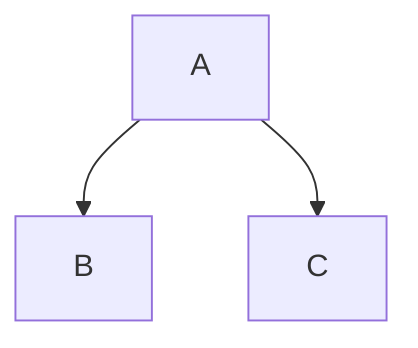

# GitHub platform layer

A mermaid diagram:



> [!NOTE]
> Useful information that users should know.

A paragraph between two alerts.

> [!WARNING]
> Urgent info that needs immediate user attention.

> [!TIP]
> Helpful advice, right after the warning.

Inline math $\sqrt{3x-1}+(1+x)^2$ in a sentence, and $5 for a coffee that is not math.

$$
\left( \sum_{k=1}^n a_k b_k \right)^2 \leq \left( \sum_{k=1}^n a_k^2 \right)
$$

```math
\frac{a}{b} = c
```

Emoji shortcodes :+1: :tada: :heavy_check_mark: and unicode 👍 🎉.

Color chips `#0969DA`, `rgb(9, 105, 218)`, `hsl(212, 92%, 45%)`.

<details>
<summary>Collapsed section</summary>

Hidden paragraph with **bold** inside.

</details>

Mention @octocat, issue #1 and commit 16c999e8c71134401a78d4d46435517b2271d6ac.
